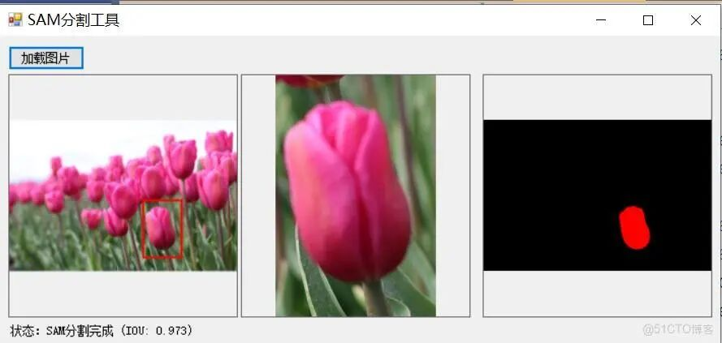
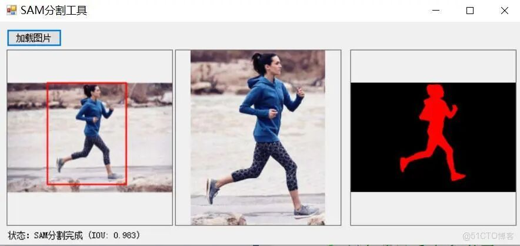

# [C#][winform] Segment Anywhere - Split Everything Deployment on ONNX Model One-Click Image Recognition Demo

[Effect Demonstration]





[Test Environment]

vs2019

net framework4.8.0

opencvsharp==4.13.0

notallow==1.24.3

[Interface Code]

```
using System; using System.Collections.Generic; using System.ComponentModel; using System.Data; using System.Drawing; using System.Linq; using System.Text; using System.Threading.Tasks; using System.Windows.Forms; using OpenCvSharp; using OpenCvSharp.Extensions; using System.IO; using System.Drawing.Imaging;   namespace FIRC {     public partial class Form1 : Form     {         private Mat originalImage;         private bool isDragging;         private System.Drawing.Point startPoint;         private System.Drawing.Rectangle selectionRect;         private Bitmap originalBitmap;         private OpenCvSharp.Rect roi;         private SamInferenceSession samSession;         private Mat samMask;         private bool isSamInitialized = false;                Mat displayImage = new Mat();         public Form1()         {             InitializeComponent();             isDragging = false;         }           private void btnLoadImage_Click(object sender, EventArgs e)         {             OpenFileDialog openFileDialog = new OpenFileDialog();             openFileDialog.Filter = "Image files (*.jpg, *.jpeg, *.png)|*.jpg;*.jpeg;*.png";             if (openFileDialog.ShowDialog() == DialogResult.OK)             {                 string imagePath = openFileDialog.FileName;                 originalImage = Cv2.ImRead(imagePath);                 if (originalImage.Empty())                 {                     lblStatus.Text = "Status: Image loading failed";                     return;                 }                   // ConvertedBitmapDisplay                 originalBitmap = BitmapConverter.ToBitmap(originalImage);                 picOriginal.Image = originalBitmap;                 picRectangle.Image = null;                 picResult.Image = null;                 lblStatus.Text = "Status: The image has been successfully loaded. Please draw a rectangle on the image.";                               }         }             private void picOriginal_MouseDown(object sender, MouseEventArgs e)         {             if (originalImage == null || originalBitmap == null)                 return;               isDragging = true;             startPoint = e.Location;             selectionRect = new System.Drawing.Rectangle(startPoint, new System.Drawing.Size(0, 0));             UpdateSelection();         }           private void picOriginal_MouseMove(object sender, MouseEventArgs e)         {             if (!isDragging || originalImage == null || originalBitmap == null)                 return;               selectionRect = new System.Drawing.Rectangle(                 Math.Min(startPoint.X, e.X),                 Math.Min(startPoint.Y, e.Y),                 Math.Abs(e.X - startPoint.X),                 Math.Abs(e.Y - startPoint.Y)             );             UpdateSelection();         }           private void picOriginal_MouseUp(object sender, MouseEventArgs e)         {             if (!isDragging || originalImage == null || originalBitmap == null)                 return;               isDragging = false;             UpdateSelection();               // Ensure the rectangle has a certain size.             if (selectionRect.Width > 10 && selectionRect.Height > 10)             {                 // Calculate the rectangular coordinates on the actual image                 // Consider the image inPictureBoxThe actual display location and size in the middle                 RectangleF imageRect = GetImageDisplayRect();                 float scaleX = (float)originalImage.Cols / imageRect.Width;                 float scaleY = (float)originalImage.Rows / imageRect.Height;                   // Calculate the coordinates relative to the image display area                 int x = (int)((selectionRect.X - imageRect.X) * scaleX);                 int y = (int)((selectionRect.Y - imageRect.Y) * scaleY);                 int width = (int)(selectionRect.Width * scaleX);                 int height = (int)(selectionRect.Height * scaleY);                   // Ensure the coordinates are within the image range.                 x = Math.Max(0, x);                 y = Math.Max(0, y);                 width = Math.Min(width, originalImage.Cols - x);                 height = Math.Min(height, originalImage.Rows - y);                   // SettingROI                 roi = new OpenCvSharp.Rect(x, y, width, height);                   // Display a rectangular area                 // Extract a rectangular area                 Mat roiMat = new Mat(originalImage, roi);                 Bitmap roiBitmap = BitmapConverter.ToBitmap(roiMat);                 picRectangle.Image = roiBitmap;                                  // RunSAMSegment                 RunSamSegmentation();               }         }           private RectangleF GetImageDisplayRect()         {             if (originalImage == null || originalBitmap == null)                 return RectangleF.Empty;               // Calculate the image in...PictureBoxThe actual display position and size in the middle             float imageAspectRatio = (float)originalImage.Width / originalImage.Height;             float pictureBoxAspectRatio = (float)picOriginal.Width / picOriginal.Height;               float displayWidth, displayHeight, x, y;               if (imageAspectRatio > pictureBoxAspectRatio)             {                 // Image comparisonPictureBoxMore, zoom in by width                 displayWidth = picOriginal.Width;                 displayHeight = displayWidth / imageAspectRatio;                 x = 0;                 y = (picOriginal.Height - displayHeight) / 2;             }             else             {                 // Image comparisonPictureBoxHigher, scale by height                 displayHeight = picOriginal.Height;                 displayWidth = displayHeight * imageAspectRatio;                 x = (picOriginal.Width - displayWidth) / 2;                 y = 0;             }               return new RectangleF(x, y, displayWidth, displayHeight);         }           private void UpdateSelection()         {             if (originalBitmap == null)                 return;               // Create a new bitmap to avoid modifying the original bitmap.             Bitmap temp = new Bitmap(picOriginal.Width, picOriginal.Height);             using (Graphics g = Graphics.FromImage(temp))             {                 // Draw the original image, considering scaling and center alignment.                 RectangleF imageRect = GetImageDisplayRect();                 g.DrawImage(originalBitmap, imageRect);                 // Draw a rectangle selection                 using (Pen pen = new Pen(Color.Red, 2))                 {                     g.DrawRectangle(pen, selectionRect);                 }             }             picOriginal.Image = temp;         }           private void ShowRectangleArea()         {             if (originalImage == null || roi.Width <= 0 || roi.Height <= 0)                 return;               // Extract a rectangular region             Mat roiMat = new Mat(originalImage, roi);             Bitmap roiBitmap = BitmapConverter.ToBitmap(roiMat);             picRectangle.Image = roiBitmap;         }           private void RunSamSegmentation()         {             if (!isSamInitialized || originalImage == null || samSession == null)             {                 lblStatus.Text = "Status：SAMModel not initialized or image not loaded";                 return;             }               try             {                 lblStatus.Text = "Status: In progressSAMSegment...";                 Application.DoEvents();                   // GetSAMInput dimensions                 OpenCvSharp.Size inputSize = samSession.GetInputSize();                                  // Adjust the image size to matchSAMInput                 Mat resizedImage = new Mat();                 Cv2.Resize(originalImage, resizedImage, inputSize);                   // Load image toSAMSession                 samSession.LoadImage(resizedImage);                   // Output:ROICoordinate scaling toSAMInput dimensions                 float scaleX = (float)inputSize.Width / originalImage.Cols;                 float scaleY = (float)inputSize.Height / originalImage.Rows;                                  int samRoiX = (int)(roi.X * scaleX);                 int samRoiY = (int)(roi.Y * scaleY);                 int samRoiWidth = (int)(roi.Width * scaleX);                 int samRoiHeight = (int)(roi.Height * scaleY);                                  // EnsureROIWithin the effective range                 samRoiX = Math.Max(0, Math.Min(samRoiX, inputSize.Width - 1));                 samRoiY = Math.Max(0, Math.Min(samRoiY, inputSize.Height - 1));                 samRoiWidth = Math.Min(samRoiWidth, inputSize.Width - samRoiX);                 samRoiHeight = Math.Min(samRoiHeight, inputSize.Height - samRoiY);                                  // CreateSAMInput dimensionsROI                 OpenCvSharp.Rect samRoi = new OpenCvSharp.Rect(samRoiX, samRoiY, samRoiWidth, samRoiHeight);                   // Run inference to get mask (using)ROIPattern）                 double iou;                 samMask = samSession.GetMask(new List<OpenCvSharp.Point>(), new List<OpenCvSharp.Point>(), samRoi, out iou);                   // Adjust the mask back to the original image size.                 Mat resizedMask = new Mat();                 Cv2.Resize(samMask, resizedMask, new OpenCvSharp.Size(originalImage.Cols, originalImage.Rows));                   // Created display results (original image)+Mask Overlay）                 //displayImage = originalImage.Clone();                                  // Create a color mask                 Mat colorMask = new Mat(originalImage.Size(), MatType.CV_8UC3, new Scalar(0, 0, 255));                 Mat maskedColor = new Mat();                 colorMask.CopyTo(maskedColor, resizedMask);                   //// Overlay mask to the original image                 //Cv2.AddWeighted(displayImage, 1.0, maskedColor, 0.5, 0, displayImage);                   //// DrawROIRectangle                 //Cv2.Rectangle(displayImage, roi, new Scalar(0, 255, 0), 2);                   // Display results                 picResult.Image = BitmapConverter.ToBitmap(maskedColor);                 lblStatus.Text = string.Format("Status：SAMSegmentation completed (IOU: {0:F3})", iou);             }             catch (Exception ex)             {                 lblStatus.Text = "Status：SAMSegmentation failed：" + ex.Message;                 MessageBox.Show(ex.ToString(), "Segmentation error", MessageBoxButtons.OK, MessageBoxIcon.Error);             }         }           /// <summary>         /// Save the segmentation result         /// </summary>         public void SaveSegmentationResult(string outputPath)         {             if (samMask == null || samMask.Empty())             {                 throw new Exception("No saved segmentation results.");             }               // Adjust the mask back to the original image size.             Mat resizedMask = new Mat();             Cv2.Resize(samMask, resizedMask, new OpenCvSharp.Size(originalImage.Cols, originalImage.Rows));               // Save mask image             Cv2.ImWrite(outputPath, resizedMask);         }           /// <summary>         /// Get the object after splitting (with transparent background)）         /// </summary>         public Mat GetSegmentedObject()         {             if (samMask == null || samMask.Empty() || originalImage == null)             {                 return null;             }               // Adjust the mask back to the original image size.             Mat resizedMask = new Mat();             Cv2.Resize(samMask, resizedMask, new OpenCvSharp.Size(originalImage.Cols, originalImage.Rows));               // CreateRGBAOutput image             Mat result = new Mat(originalImage.Size(), MatType.CV_8UC4);                          // Convert the original image toRGBA             Mat originalRgba = new Mat();             Cv2.CvtColor(originalImage, originalRgba, ColorConversionCodes.BGR2BGRA);               // Apply mask asalphaChannel             for (int i = 0; i < result.Rows; i++)             {                 for (int j = 0; j < result.Cols; j++)                 {                     Vec4b pixel = originalRgba.At<Vec4b>(i, j);                     byte maskValue = resizedMask.At<byte>(i, j);                                          result.At<Vec4b>(i, j) = new Vec4b(pixel.Item0, pixel.Item1, pixel.Item2, maskValue);                 }             }               return result;         }           private void Form1_Load(object sender, EventArgs e)         {             try             {                 // Load model                 string encoderPath = Path.Combine(AppDomain.CurrentDomain.BaseDirectory, "models", "mobile_sam_preprocess.onnx");                 string decoderPath = Path.Combine(AppDomain.CurrentDomain.BaseDirectory, "models", "mobile_sam.onnx");                   lblStatus.Text = "Status: Model is being initialized...";                                  // CreateSAMInference session                 samSession = new SamInferenceSession(encoderPath, decoderPath, 4);                 isSamInitialized = true;                                  lblStatus.Text = "Status: Model loaded successfully";             }             catch (Exception ex)             {                 lblStatus.Text = "Status: Model loading failed：" + ex.Message;                 // Display detailed error messages                 MessageBox.Show(ex.ToString(), "Error", MessageBoxButtons.OK, MessageBoxIcon.Error);                 isSamInitialized = false;             }         }     } }
```

[Support Models]

EDAGE-SAM model:

edge_sam_3x_decoder.onnx

edge_sam_3x_encoder.onnx

Mobile Sam model:

mobile_sam.onnx

mobile_sam_preprocess.onnx

Sam model:

sam_hq_preprocess.onnx

sam_hq_vit_h.onnx

[Reference]

GitHub repository: dinglufe/segment-anything-cpp-wrapper

[Note]

The mobile_sam framework is used for segmentation, and CPU inference is employed, which is relatively fast. No need to install CUDA+cuDNN and NVIDIA graphics cards, greatly reducing the configuration of computer hardware.

[Source Code URL]


## Payment

Here is a pay link on Stripe ( https://buy.stripe.com/3cs8yP7sY87d0vu9AB ). Please contact me lonlonago@foxmail.com after funding $89, and I will send you a complete data files , thank you!


